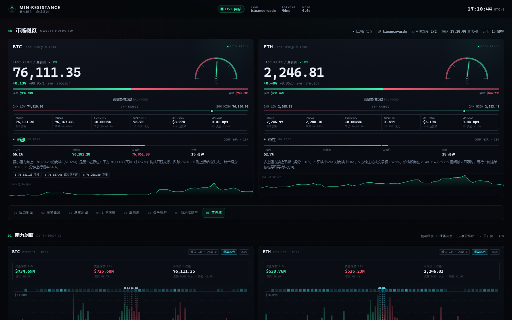

# MIN-RESISTANCE · 最小阻力

比特币与以太坊的实时价格分析终端，只围绕一个判断：

> **价格总是朝阻力最小的方向移动。**

系统把「阻力」拆成五类可观测的证据——盘口挂单堆积、墙与冰山（含撤单/回补）、
逐笔主动买卖流、清算带、以及盘口真空——加权成一个方向分数，并给出 15 分钟后的
目标位与失效位。前端是零依赖的深色终端，后端是纯 Python asyncio 服务。



## 快速开始

```powershell
cd least-resistance
python -m pip install -r requirements.txt
python run.py --mode auto        # 有外网走币安实时数据，否则自动切换模拟器
```

打开 <http://127.0.0.1:8765/>。`--mode live` 只用真实数据，`--mode sim` 只用
离线模拟器（无需外网，适合演示与测试）：

```powershell
python run.py --mode sim --port 8766
```

## 数据与模式

| 模式 | 数据来源 | 用途 |
| --- | --- | --- |
| `live` | 币安 USD-M 永续：REST 深度快照 + `@depth@100ms` 增量、逐笔成交、资金费率、持仓量、K 线 | 真实行情 |
| `sim` | 内置随机游走 + 合成订单簿/冰山/墙/强平/逐笔 | 离线演示、视觉验收、测试 |

两种模式的 snapshot 结构完全一致，前端无差别消费。本机环境里币安 USD-M WS 的
`aggTrade` / `ticker` / `markPrice` 流可能静默（`@depth@100ms` 与 `@bookTicker`
正常）。后端因此：① 优先用现货 `aggTrade` WS 镜像成交，并按
`futures_mid / spot_mid` 把价格换算到期货币对，保证墙/冰山的成交量归因仍然对齐；
② 现货 WS 也不可用时，退回 `/fapi/v1/trades` REST 轮询（6s，weight 5，而非
weight 20 的 `aggTrades`）；③ 行情 / 资金费率 / 持仓量 / K 线每 45s 刷新。
若交易所返回 418/429，后端按 `Retry-After` 暂停全部 REST，避免把封禁拖长；
盘口仍由 100ms 增量维持。

**诚实标注**：真实强平事件依赖 `!forceOrder` 流，部分网络环境收不到，此时
「实际强平」为 0；页面同时展示按 5m 成交量与杠杆分布反推的「模型估算清算带」，
两者在 UI 中始终分开标注，不把估算当成交。

## 它如何判断方向

| 信号 | 权重 | 读法 |
| --- | --- | --- |
| 盘口失衡 | 0.30 | 买盘深度相对卖盘越厚，上行阻力越小 |
| 墙与冰山 | 0.24 | 近端大挂单/隐藏吸收越重，该方向越难走 |
| 清算带 | 0.22 | 上方空头清算密集→向上磁吸；下方多头清算密集→向下磁吸 |
| 主动流 | 0.14 | 5 分钟主动买卖差（CVD 斜率） |
| 盘口真空 | 0.10 | 某一侧 0.5–2% 内深度稀薄，价格更容易滑向该侧 |

加权分数 `score ∈ [-1, 1]`，>0 表示上行阻力更小；`p_up = sigmoid(2.4·score)`。
`|score| < 0.07` 视为中性。系统每 60 秒记录一次预测，15 分钟后按真实价格结算
方向是否命中，并计算 Brier 分数；页面上展示滚动准确率，而不是只展示“好看”的
当前判断。

详细公式、阈值与已知局限见 [docs/methodology.md](docs/methodology.md)。

## 项目结构

```
least-resistance/
  run.py                 启动入口（模式探测、优雅关闭）
  server/
    config.py            全部阈值与权重
    feed.py              币安实时数据（WS + REST 兜底 + 断线重连）
    sim.py               离线模拟行情
    book.py              本地订单簿重建、回补/撤单元数据
    analytics.py         挂单堆积、墙、冰山、摩擦曲线、清算地图
    predictor.py         15 分钟预测账本与结算
    hub.py               汇总 snapshot、事件流、预测叙述
    app.py               aiohttp 站点 + /api + /ws
  web/                   零依赖前端（HTML/CSS/Canvas）
  tests/                 后端测试（pytest）
  docs/API.md            snapshot 字段契约
  docs/methodology.md    方法论与局限
```

## 接口

- `GET /api/snapshot` — 完整市场快照（约 110–150 KB）
- `GET /api/health` — 进程与数据源状态
- `WS /ws` — 先发一帧完整快照，之后约每 0.9s 推送一帧
- 字段契约见 [docs/API.md](docs/API.md)；`?mock=1` 可用 `web/mock/snapshot.json` 离线预览前端

## 测试

```powershell
python -m pytest tests -q
```

覆盖订单簿重建与重同步、回补检测、墙/冰山/清算分析、预测结算、hub 快照、
模拟器盘口不交叉、HTTP/WS 接口、撤单判定与现货成交镜像，共 40 项。前端视觉
验收使用 Playwright 截图到 `screenshots/final-desktop.png` 与
`screenshots/final-mobile.png`；`?mock=1` 离线预览见 `screenshots/final-mock-desktop.png`。

## 免责声明

本项目仅用于行情结构研究与工程演示，不构成任何投资建议。加密资产价格波动
剧烈，订单簿与清算数据存在延迟、缺失与被操纵的可能，任何预测都可能失效。
