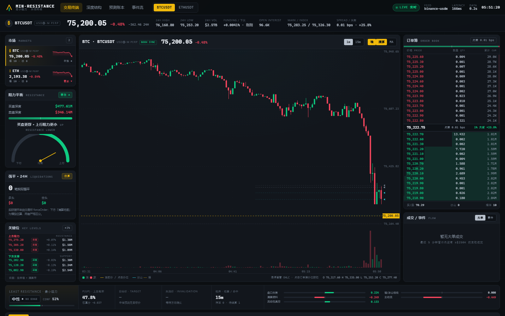

# MIN-RESISTANCE · 最小阻力

比特币与以太坊的实时价格分析终端，只围绕一个判断：

> **价格总是朝阻力最小的方向移动。**

系统把「阻力最小」具体化为**流动性扫荡**：价格更愿意去流动性更厚、更容易成交的一侧。
它把上下两侧可扫荡的流动性——盘口挂单、冰山隐藏量、模型估算清算池、已实现清算——
按距离衰减加权，再叠加主动成交流、墙/冰山吸收、已实现清算流与流动性真空，得到
15 分钟方向、最厚扫荡目标位与失效位。页面是零依赖的交易所风格终端（K 线、订单簿梯、
成交 tape、预测 rail），分析逻辑是一套纯 Python 代码，既能跑在本地服务端，也能在
浏览器里用 Pyodide 原样运行。

## 在线体验（无需安装）

**<https://kfat77.github.io/least-resistance/>**

GitHub Pages 只托管静态文件；页面第一次加载会下载约 13 MB 的 Pyodide/WASM
运行时，然后在 Web Worker 里执行**与本地后端完全相同**的 Python 分析。行情由
浏览器直接向币安公共接口获取：

1. 优先 USD-M 永续（fapi / fstream）：资金费率、持仓量、真实强平、标记价格齐全；
2. 如果当前网络访问不了期货接口，自动回退到币安现货公共行情
   （`data-api.binance.vision` / `data-stream.binance.vision`）：盘口、逐笔、K 线
   仍为真实数据，但**资金费率 / 持仓量 / 标记价格显示 `—`，实际强平为 0**，
   清算带仅保留模型估算，页面会标注「现货 SPOT」。



> 其他截图：[现货回退模式](screenshots/pages-spot.png) ·
> [移动端](screenshots/pages-online-mobile.png) ·
> [离线 mock 预览](screenshots/pages-mock.png) ·
> [关键位与交易所布局](screenshots/exchange-desktop.png)

## 本地运行（完整后端）

```powershell
cd least-resistance
python -m pip install -r requirements.txt
python run.py --mode auto        # 有外网走币安实时数据，否则自动切换模拟器
```

打开 <http://127.0.0.1:8765/>。`--mode live` 只用真实数据，`--mode sim` 只用
离线模拟器（无需外网，适合演示与测试）：

```powershell
python run.py --mode sim --port 8766
```

也可以只验证浏览器静态版：

```powershell
python scripts/build_site.py --download      # 组装 _site/（含 Pyodide）
python -m http.server 8772 --directory _site # 打开 http://127.0.0.1:8772/
```

## 数据与模式

| 模式 | 数据来源 | 用途 |
| --- | --- | --- |
| Pages 永续 | 浏览器直连币安 USD-M：depth@100ms、逐笔、ticker、markPrice、K 线 | 默认在线模式 |
| Pages 现货 | 浏览器直连币安现货公共行情，期货不可达时自动回退 | 受限网络下的在线模式 |
| `live` | 本地 Python 后端连币安 USD-M（WS + REST 兜底） | 完整后端 / 自托管 |
| `sim` | 内置随机游走 + 合成订单簿/冰山/墙/强平/逐笔 | 离线演示、视觉验收、测试 |

静态版的 `snapshot` 与后端版结构一致，只多出 `market`（`futures` / `spot`）与
`market_label`（`现货 SPOT` / `USDⓈ-M PERP`）用于诚实标注；数据源见
`feed.source`（`binance-usdm` / `binance-spot`）。字段契约见
[docs/API.md](docs/API.md)。

本机环境里币安 USD-M WS 的 `aggTrade` / `ticker` / `markPrice` 流有时静默
（`@depth@100ms` 与 `@bookTicker` 正常）。后端因此：① 优先用现货 `aggTrade` WS
镜像成交，并按 `futures_mid / spot_mid` 把价格换算到期货币对；② 现货 WS 也不可用
时退回 `/fapi/v1/trades` REST 轮询（6s，weight 5）；③ 行情 / 资金费率 / 持仓量 /
K 线每 45s 刷新；④ 交易所返回 418/429 时按 `Retry-After` 暂停全部 REST，避免把
封禁拖长。

**诚实标注**：真实强平事件依赖 `!forceOrder` 流，部分网络环境收不到，此时
「实际强平」为 0；页面同时展示按 5m 成交量与杠杆分布反推的「模型估算清算带」，
两者在 UI 中始终分开标注，不把估算当成交。现货回退模式没有资金费率/持仓量/
标记价格，页面显示 `—`，不伪造数据。

## 它如何判断方向

| 信号 | 权重 | 读法 |
| --- | --- | --- |
| 流动性扫荡 | 0.68 | 上方/下方 3% 内挂单、冰山隐藏量、清算池按距离衰减加权；厚的一侧是扫荡目标 |
| 主动成交流 | 0.14 | 5 分钟主动买卖差（CVD 斜率） |
| 墙/冰山吸收 | 0.08 | 近 2 分钟墙/冰山真实吸收的主动流方向（含回补加成），而不是挂单大小 |
| 已实现清算流 | 0.05 | 近 5 分钟 forceOrder 平仓方向：空头清算=强制买入，多头清算=强制卖出 |
| 流动性真空 | 0.05 | 某一侧 1.5–3% 内深度稀薄，价格更容易滑向该侧 |

扫荡分不是把挂单当成磁铁：它先按 `exp(-距离/1.2%)` 给每个流动性池加权，再分别
归一化盘口/冰山/估算清算/已实现清算四个来源，避免金额尺度最大的估算清算图淹没
盘口。`score > 0` 表示上方可扫荡流动性更厚、价格倾向向上扫穿，`p_up = sigmoid(2.4·score)`，
`|score| < 0.07` 视为中性。估算清算池只进入扫荡分，已实现强平单独形成清算流信号，
不重复计分；`bid_depth_usd` / `ask_depth_usd` 仍是最外层 ±3% 窗口的深度，而不是
各嵌套档位求和。目标价取预测方向上 0.08%–1.2% 内**最厚**的扫荡池；失效价为反方向
最近挂单墙。系统每 60 秒记录一次预测，15 分钟后按真实价格结算方向是否命中，并计算
Brier 分数；页面上展示滚动准确率，而不是只展示「好看」的当前判断。详细公式、阈值
与局限见 [docs/methodology.md](docs/methodology.md)。

### 墙模式 A/B（WALL_MODE）

同一面墙可以有两种互斥解读：`barrier` 把买墙视为支撑、卖墙视为压制（墙挡住价格）；
`magnet` 把大额挂单视为磁吸位（买墙把价格往下吸、卖墙往上吸）。系统不靠主观偏好
选边，而是让两种解读**在同一段行情上并行记账**：当前 `WALL_MODE` 驱动页面展示，
另一种模式写入影子账本；两者都按 60 秒记录、15 分钟结算，分别统计命中率与 Brier。
服务端每 2 秒在后台生成一次快照推进账本（`LEDGER_TICK_S`），所以没有人打开页面时
A/B 仍会积累样本；静态站则由浏览器内的 Worker 每 900ms 推进。

- 页面切换：顶栏 **「墙模式 WALL」** 分段控件（障碍 BARRIER / 磁铁 MAGNET），
  点击即时切换并高亮当前模式；旁边徽标显示影子账本正在记录的另一模式。本地站
  通过 `POST /api/wall-mode` 切换并持久化到 `data/<mode>/wall_mode.txt`；静态站
  在 Worker 内切换，选择记在浏览器 `localStorage`。
- 启动默认值：`python run.py --mode live --wall-mode magnet`，或设置环境变量
  `WALL_MODE=magnet`（仅接受 `barrier` / `magnet`，非法值启动即报错）。显式环境
  变量优先于页面上次选择。
- 对比：`python scripts/compare_wall_modes.py --url http://127.0.0.1:8765/api/snapshot`。
- 决策规则：两种模式各累计至少 20 条已结算窗口（Brier 按全部已结算窗口计算，
  方向命中率作为辅助指标）；若一方 Brier 至少低 0.02 且命中率不更差，则采用该模式
  为默认值，否则保留 `barrier`（避免把样本噪声当成优势）。结果字段见
  [docs/API.md](docs/API.md)（`accuracy_ab` 与 `accuracy_alt_ab`）。

本次实测（2026-11-09 06:19 UTC+8，live 服务器本次进程启动后的 A/B）：

| 范围 | 已结算窗口 | 方向样本 | barrier 命中率 / Brier | magnet 命中率 / Brier |
| --- | --- | --- | --- | --- |
| BTCUSDT | 20 | 6 | 33.3% / 0.2560 | 16.7% / 0.2639 |
| ETHUSDT | 20 | 17 | 76.5% / 0.2101 | 76.5% / 0.2101 |
| 合计 | 40 | 23 | 65.2% / 0.2330 | 60.9% / 0.2370 |

合计 Brier 差距 0.0040，小于 0.02 的决策门槛，因此按规则**保留 `barrier` 为默认**。
15 分钟视界与 60 秒记录频率使相邻预测窗口高度重叠，当前样本量只够做阶段性判断，
服务端会继续并行记账，后续可用同一脚本复查。

## 项目结构

```
least-resistance/
  run.py                 本地后端入口（模式探测、优雅关闭）
  server/
    config.py            全部阈值与权重
    feed.py              币安实时数据（WS + REST 兜底 + 断线重连）
    sim.py               离线模拟行情
    book.py              本地订单簿重建、回补/撤单元数据
    analytics.py         挂单堆积、墙、冰山、摩擦曲线、清算地图
    predictor.py         15 分钟预测账本与结算
    hub.py               汇总 snapshot、事件流、预测叙述
    app.py               aiohttp 站点 + /api + /ws
  web/                   零依赖前端（HTML/CSS/Canvas）
    js/engine-worker.js  浏览器版引擎：Pyodide + 直连币安 + 900ms 快照
    js/app-client.js     静态版入口：Worker 传输、mock、状态与重连
  scripts/build_site.py  组装 _site/（复制前端、Python 分析源码与 Pyodide）
  .github/workflows/     GitHub Pages 自动构建部署
  tests/                 后端测试（pytest）
  docs/API.md            snapshot 字段契约
  docs/methodology.md    方法论与局限
```

## 部署（GitHub Pages）

页面必须由 Pages 以 **GitHub Actions** 方式发布（仓库 Settings → Pages →
Source = GitHub Actions）。推送 `main` 后 workflow 会下载 Pyodide、运行
`scripts/build_site.py --download`，把 `_site/`（约 13.6 MB）发布到
`https://kfat77.github.io/least-resistance/`。`_site/`、`.cache/`、data 与日志
均已加入 `.gitignore`，不会提交。

## 接口

本地后端：

- `GET /api/snapshot` — 完整市场快照（约 110–150 KB）
- `GET /api/health` — 进程与数据源状态
- `WS /ws` — 先发一帧完整快照，之后约每 0.9s 推送一帧
- 字段契约见 [docs/API.md](docs/API.md)；`?mock=1` 可用 `web/mock/snapshot.json` 离线预览前端

静态版没有 HTTP API，浏览器直接消费引擎产出的同结构 snapshot。

## 测试

```powershell
python -m pytest tests -q
```

覆盖订单簿重建与重同步、回补检测、墙/冰山/清算分析、预测结算、hub 快照、
模拟器盘口不交叉、HTTP/WS 接口、撤单判定与现货成交镜像，共 56 项。静态版另用
Playwright 验收：永续、强制现货回退、430px 移动端、`?mock=1` 四种场景均为
0 console error / 0 横向溢出、28 档梯、7 个 canvas，截图见
`screenshots/pages-*.png`。

## 已知局限

- 浏览器版首次加载需要下载约 13 MB Pyodide 运行时（热缓存后约 1.5–2.3 秒初始化）。
- 现货回退模式没有真实资金费率、持仓量与强平数据，清算带只有模型估算。
- 浏览器直连公共行情受交易所 CORS、区域网络与限流影响；接口不可达时页面会明确
  显示断开/重连状态，而不是假装 LIVE。
- 订单簿只保留近端深度（1000 档内），清算与冰山是从成交/挂单结构推断的估计值。

## 免责声明

本项目仅用于行情结构研究与工程演示，不构成任何投资建议。加密资产价格波动
剧烈，订单簿与清算数据存在延迟、缺失与被操纵的可能，任何预测都可能失效。
